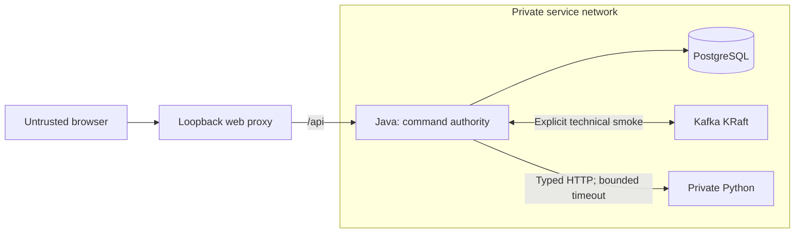

# Architecture

SR-001 implements a runnable technical foundation. Business workflows and
authentication are not implemented yet.

| Component | Responsibility |
| --- | --- |
| `backend/` | One Java/Spring Boot modular monolith; future business commands and authorization |
| PostgreSQL | Canonical operational state; Flyway-managed baseline schema, no business tables yet |
| Kafka | Asynchronous transport; explicit infrastructure-only producer/consumer smoke |
| `intelligence/` | Private Python/FastAPI computation; no operational DB credentials or stock writes |
| `frontend/` | React/strict TypeScript shell; real service status and truthful empty/error states |
| `contracts/` | Shared versioned technical schemas and safe fixtures |
| `infrastructure/`, root `compose.yaml` | One local topology, images and same-origin proxy |
| `scripts/`, `.github/` | Development checks and reproducible CI |

Only the proxy publishes a local loopback port. Python is not proxied to the
browser and receives no database credentials. Java uses a limited PostgreSQL
role; migrations are validated on startup. Network membership alone does not
provide service authentication.

`/api/health/liveness` checks the Java process, `/api/health/readiness` includes
the database, and `/api/health/integration` checks Kafka and Python. A Kafka or
Python outage does not make database readiness fail. The UI labels its status
as backend readiness. The shared `contracts/` schema and fixture describe only
Python's versioned technical health response. Kafka traffic is limited to the
owned `stockrescue.infrastructure.smoke.v1` topic and the explicit smoke command.

Builds use Gradle Wrapper/Kotlin DSL, strict Gradle locks, `uv.lock`, frozen pnpm
dependencies, Tailwind 4 with its Vite plugin, and pinned container digests.
Java 27 is the selected stable release; Java 28 is Early Access as of 2026-10-28.
TypeScript 7 compiles the frontend; the TypeScript 6 compatibility package serves
ESLint's API until typescript-eslint supports the native compiler. Dependency
installation blocks unapproved build scripts and verifies package integrity;
the narrowly pinned legacy semver exception has an additional signature/hash check.

Business entities, stock workflows, forecasts and business outbox/inbox are
outside the technical bootstrap. Local task materials stay in the ignored
`documents/prompts/` directory.
