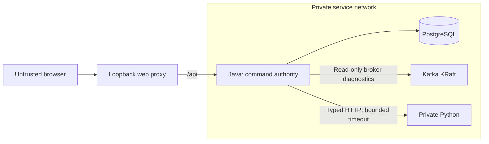

# Architecture

SR-001 implements a runnable technical foundation. Business workflows and
authentication are not implemented yet.

| Component | Responsibility |
| --- | --- |
| `backend/` | One Java/Spring Boot modular monolith; future business commands and authorization |
| PostgreSQL | Canonical operational state; Flyway-managed baseline schema, no business tables yet |
| Kafka | Transport infrastructure; read-only runtime diagnostics and isolated producer/consumer tests |
| `intelligence/` | Private Python/FastAPI computation; no operational DB credentials or stock writes |
| `frontend/` | React/strict TypeScript shell; real service status and truthful empty/error states |
| `contracts/` | Shared versioned technical schemas and safe fixtures |
| `infrastructure/`, root `compose.yaml` | One local topology, images and same-origin proxy |
| `scripts/`, `.github/` | Development checks and reproducible CI |

Only the proxy publishes a local loopback port. Python is not proxied to the
browser and receives no database credentials. Java uses a limited PostgreSQL
role; migrations are validated on startup. Network membership alone does not
provide service authentication.

Flyway metadata stays in `public.flyway_schema_history` to preserve initialized
SR-001 databases and the unchanged V001 checksum. Migrations must qualify application
objects as `stockrescue.*`; pooled JDBC connections use only `stockrescue`, with no
fallback to `public` if that schema is missing. The local `stockrescue_app` role owns
the application schema and migration history and currently performs both migration
and runtime work. A separate migration/runtime role split belongs to deployment hardening.

`/api/health/liveness` checks the Java process, `/api/health/readiness` includes
the database, and `/api/health/integration` checks Kafka and Python. A Kafka or
Python outage does not make database readiness fail. The UI labels its status
as backend readiness. These Actuator routes are the only HTTP API in SR-001;
business OpenAPI is deferred until the first business endpoint exists. The shared
`contracts/` schema and fixture describe only Python's versioned technical health
response. Runtime Kafka diagnostics describe
the cluster without creating or requiring a smoke topic. Java producer/consumer
checks live only in tests. Compose checks own a temporary topic and use bounded
Kafka CLI clients in ephemeral containers on the private network; the backend
remains one Spring Boot process.

Builds use Gradle Wrapper/Kotlin DSL, strict Gradle locks, `uv.lock`, frozen pnpm
dependencies, Tailwind 4 with its Vite plugin, and pinned container digests. The
backend runs on Oracle Linux 9 slim with a Java runtime linked from the pinned JDK;
new reflective module use must remain covered by the image integration check.
Java 27 is the selected stable release; Java 28 is Early Access as of 2026-10-28.
TypeScript 7 compiles the frontend; the TypeScript 6 compatibility package serves
ESLint's API until typescript-eslint supports the native compiler. Dependency
installation blocks unapproved build scripts and verifies package integrity;
packages must also meet the configured minimum release age.

Business entities, stock workflows, forecasts and business outbox/inbox are
outside the technical bootstrap. Local task materials stay in the ignored
`documents/prompts/` directory.
