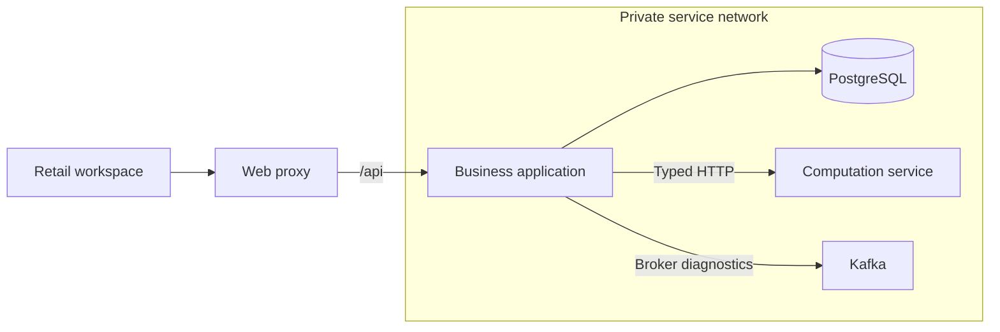

# Architecture

StockRescue organizes retail teams around organizations, stores, storage
compatibility and approved transport assumptions. PostgreSQL holds the operational
records; the Java backend authorizes commands and commits their audit evidence.

## Runtime responsibilities

| Component | Responsibility |
| --- | --- |
| Java / Spring Boot | Accounts, organizations, access decisions, catalog and inventory commands, store configuration and transport cost history in one modular application. |
| PostgreSQL | Business records, constraints, transaction ordering, audit history and persisted sessions. |
| React / TypeScript | Account and organization workspaces, forms, scoped navigation and service status. |
| Python / FastAPI | A private computation service with a versioned health contract. |
| Kafka | Durable inventory change events and asynchronous derived views. |
| Nginx / Docker Compose | Same-origin browser access and the local service topology. |

The web proxy publishes the local loopback port. Service addresses and database
credentials are supplied explicitly. The Java application uses the restricted
`stockrescue_app` database role; the computation service has its own configuration.

Liveness checks the Java process, readiness checks its database connection, and
integration health checks Kafka, Python and the inventory listener. The workspace
displays the backend's readiness result.

## Application boundaries

Feature packages keep HTTP controllers, application use cases, domain rules and
JDBC repositories together:

| Package | Business responsibility |
| --- | --- |
| `identity` | Registration, credentials, authentication and active account status. |
| `organizations` | Organization creation and the creator's durable onboarding result. |
| `access` | Memberships, invitations, store assignments, revocation and authorization policy. |
| `stores` | Store metadata, storage zones, directed transport lanes and cost revisions. |
| `catalog` | Organization products, manufacturer lot registration and scoped source evidence. |
| `inventory` | Physical receipts, stock quantities, reservations, holds and immutable movement evidence. |
| `transfers` | Store-to-store requests, reservation ownership, physical custody, reconciliation and transfer events. |
| `platform` | HTTP/security adapters, sessions, transactions, correlation and audit persistence. |

Controllers validate and translate requests. Application services own command
transactions and delegate SQL to repositories. Organization creation calls the
access use case to establish initial ownership in the same transaction. Store
commands obtain authorization through the shared access policy.

## Catalog identity decisions

Product identity is organization-scoped with a stable UUID and canonical SKU.
SKU input trims ASCII spaces, accepts up to 64 ASCII letters, digits, `.`, `_`,
`/` and `-`, and uppercases letters with `Locale.ROOT`; non-ASCII identifiers
are rejected rather than Unicode-normalized. GTIN remains text, preserving
leading zeroes, and its 8, 12, 13 or 14 digits include a validated check digit.
The initial unit is `EA`.

Duplicate GTINs remain separate product identities. Creation previews active and
archived organization matches and requires explicit operator confirmation against
the complete match-set revision; a per-organization/GTIN transaction lock rejects
stale reviews. The revision guards freshness and does not grant authorization.

Active organization members can read catalog metadata through `READ_CATALOG`;
Org Admins manage it through `MANAGE_CATALOG`. Product creation and archival use
actor/organization/operation-scoped request identifiers and canonical payload
digests. Product, recorded outcome and audit commit atomically. An unchanged
retry returns the recorded product identity with its current state after checking
current access. Archival retains the UUID and reserved SKU.

Manufacturer lot codes alone are not globally unique. Lot identity remains
organization/product-scoped; unverified manufacturer evidence cannot merge
candidates. Each source or consignment observation has its own identity and does
not represent received quantity or physical custody. Store associations describe
metadata only.

Confirmed lot identity requires an exact manufacturer reference, explicit review
and recorded evidence; the server records the confirming membership and time.
Store Managers and Inventory Operators register source observations for assigned
active stores. Administrators can also register organization-level sources.
Source reads filter documents by current grants and active stores; administrators
retain organization-wide history. Trace pages state their visibility scope and
describe recorded evidence rather than exact per-unit origin. Unknown supplier
details remain null.

Date markings retain the original label, type, precision and available source.
Partial or unknown dates do not receive an inferred cutoff. A normalized cutoff
is separate evidence tied to an explicit policy version and normalization rule.
Label parsing recognizes explicit ISO day, month and year formats and reports
VALID, INCOMPLETE or INVALID evidence while retaining the original text.

Administrators correct lot metadata against an expected version after reviewing
replacement evidence and providing a reason. Each correction preserves exact
before/after rows, the acting membership and server time alongside its durable
request result. Metadata, immutable history and audit commit together. Replays
return the recorded correction with the current lot state; conflicting edits
require another review. Stable lot and source identities survive corrections.
Known manufacturer identity is protected; candidate confirmation requires explicit
reviewed evidence. Increased date precision requires an actual label and source
reference. Corrections clear prior normalization so subsequent evaluation uses
the revised evidence.

Food-safety assessment combines immutable platform rules with operator-entered,
source-attributed observations. These records are auditable but do not independently
verify source contents. A public match is only a suggestion; no matching alert does
not establish absence of a recall. Missing or unavailable evidence stays unknown.

The local pilot is limited to sealed, packaged, shelf-stable dry bakery products
whose original package or supplier document supports BAKERY, AMBIENT and that
specific profile. Perishable, cream-filled, refrigeration-dependent or uncertain
products remain under review. A positive assessment also requires a confirmed
manufacturer lot, a complete original day-precision label with source reference,
referenced recall and damage observations, and active compatible storage context.
The source-backed category, declared temperature and product profile are
recorded together against a new product version. The result is a point-in-time
check of recorded evidence, not certification or permission to sell, donate,
transfer or move stock. `NOT_REPORTED` means only that no issue was reported in
the evidence reviewed. Missing evidence remains under review; known recalled,
damaged, expired or archived records and incompatible storage are denied.

Eligibility uses an injected clock, the store's time zone and a coherent snapshot
of lot, product, store, zone and policy versions. Each request recomputes the
decision and returns ordered reasons, evidence status, input versions, the active
ruleset identity and a next action. The platform selects rules only by an exact
supported category, temperature and assessment operation; tenant policy records
are supplementary evidence and never select a fallback or replace those rules.
Platform rules are immutable and cannot be weakened by tenant policy. Tenant policy
reviews preserve source-attributed history but do not approve stock operations,
change these rules or select a fallback. Declared zone compatibility describes
configuration rather than continuous cold-chain verification.

Future `ProductReferenceProvider` and `SafetyAlertProvider` adapters remain
optional, source-linked suggestions fetched outside the evaluator. Open Food Facts
requires license, attribution and quota review; RASFF and GIS matches cannot prove
that a lot is not recalled, and a stable GIS feed must be established first; GS1
identity checks require acceptable commercial terms. Persist source identity,
fetch/publication times, raw-data hash, freshness and match explanation. The
current assessment stays offline and never promotes an external match to verified
evidence.

| Evidence state | Assessment | Meaning |
| --- | --- | --- |
| Source-confirmed packaged shelf-stable dry BAKERY / AMBIENT scope, complete attributed evidence, no known block | ALLOWED | Limited platform checks passed for this snapshot; no operation is authorized. |
| Unknown, incomplete, stale or unsupported evidence/scope | REQUIRES_REVIEW | Resolve the named evidence gaps; do not infer safety. |
| Known recall, damage, expiry, archive or incompatible storage | DENIED | A hard block remains in every assessment. |

Storage locations belong to one store and retain their code and zone identity.
Administrators and assigned Store Managers configure names and archival; current
store grants control reads. Active locations prevent zone archival through a
PostgreSQL foreign key to the active zone identity and appear in its impact
preview. Store archival retains location history while making its configuration
unusable. Eligibility resolves the selected location's zone and rejects archived
locations or inactive parents.

## Inventory records

A stock position identifies one organization, store, storage location, product and
manufacturer lot. Composite foreign keys keep those identities consistent. An
uninitialized position carries no assertion about physical stock; an initialized
zero is distinct. Quantities use integer pieces and explicit overflow checks.

The immutable movement journal records physical quantity deltas and changes to
reserved, quarantined and other blocked quantities. These buckets are disjoint;
availability is derived from on-hand stock. Position updates require a matching
journal version. Reservation and hold ownership retain immutable transitions,
including partial releases and consumption. Deferred database constraints check
the journal, ownership, position and pending event together at commit.

Physical receipts retain supplier document and line identities independently of
command retry keys. Source observations remain separate evidence. Command outcomes,
movement history, reconciliation findings and outbox event contents are immutable.
Delivery leases are stored separately from event contents. The inbox and derived
change feed provide scoped persistence for asynchronous processing.

Before an inventory mutation, the application records a bounded command intent for
the current actor, organization, store and position (or receipt document). Its
payload stays server-side; recovery lists expose only intent metadata and use
bounded 100-item pages, with exact-subject checks for the active form. Execution
rechecks current authorization and uses the normal inventory command path. A pending
intent remains until its committed result is acknowledged or a rejected request is
explicitly reviewed, so reloads and concurrent tabs cannot create a fresh request.

Inventory changes commit to PostgreSQL before Kafka delivery. A bounded relay
claims rows with expiring fenced leases, publishes in aggregate-version order and
marks delivery only after broker acknowledgement. During a broker outage, stock
commands continue to commit while the outbox backlog grows; retries use capped
jittered delays, and operators can observe pending count, oldest age, attempts,
errors and projection staleness through authenticated metrics. Poison events are
parked and block later versions of their aggregate. An organization administrator
can request a scoped, reasoned and audited redrive of the same immutable event;
each new generation has its own fenced lease and only a persisted broker ACK
releases the ordering gap. Invalid source evidence remains blocked for engineering
review. The consumer stores an idempotent receipt and a monotonic derived view
without changing stock balances. Redrive lifecycle and irreparable-source handling
are recorded as immutable, scoped attempts. A redrive republishes the same event
only after source validation and a durable broker acknowledgement; delivery state
does not mutate the event or stock ledger.
The local Compose broker stores its logs in the named `kafka_dev_data` volume,
which survives ordinary `down`/`up` and is removed by `down --volumes` together
with PostgreSQL's development data. Local Kafka retention is finite at seven
days: broker acknowledgement is not a promise of permanent storage or replay
after retention expires. Replication and backups need a separate production
design.
The projection consumer acknowledges only after its inbox transaction or durable
invalid-event record commits. Known invalid records are parked; transient
infrastructure failures retry the same offset with capped jitter. Unknown
application failures pause the listener container for five minutes, retain the
offset and expose category, offset, age and paused state through `inventoryMessaging`
health and metrics without event payloads. After deploying a correction, restart
the consumer to resume the same group offset; do not skip it. Kafka health remains
separate from database-backed API health.
Event correlation IDs are nullable opaque strings using the same safe 1-to-64
character syntax accepted by HTTP; UUID values remain valid, while event, tenant,
aggregate and causation identities remain UUIDs.

Inventory commands lock current store authority before catalog context and stock
positions. Product and lot locks serialize safety-evidence changes with stock
writes. Sales and reservations re-evaluate current evidence, while received units
with incomplete or blocking evidence enter quarantine. Releasing a hold into
available stock requires a current eligible assessment. Operators release their own
allocations; managers may manage another operator's allocations and perform audited
adjustments and write-offs, including disposal from a named blocked allocation.

Retry identities are scoped by organization, actor and operation and retain a
fingerprint of normalized reviewed values. A retry returns the recorded logical
outcome after current authorization. Changed values conflict. Receipt document
identity independently prevents a second physical delivery posting under a new
request key. Position, allocation transitions, receipt, command outcome, audit and
pending event commit together. An uncertain response is recovered with the captured
request identifier and original values.

The multi-line receipt endpoint retains up to 50 original supplier lines in one
physical document. It groups lines by product, lot and storage location, requires
one expected version per group, and adds quantities with overflow checks. Each
position advances once and emits one ordered event; every original line keeps its
own reference, quantity and disposition under the shared movement and receipt
header. Lines that fail current lot safety review enter quarantine as one aggregate
allocation for their position group.

Reconciliation takes a store-scoped exclusive transaction lock while stock commands
take its shared form, then rebuilds balances and allocation ownership from immutable
movement and lifecycle evidence. Critical mismatches freeze only affected positions;
the run and its findings remain durable across restarts. An organization administrator
may rebuild a frozen projection only when its ledger and allocation history validate.
That repair is recorded as immutable evidence and a zero-quantity movement; it never
rewrites prior history. Corrupt source history remains frozen for investigation.

## Store transfers

Transfers move stock between two distinct stores in one organization. The
`transfers` application package coordinates current store permissions, the
approved lane revision, inventory postings, immutable custody evidence and
command recovery. PostgreSQL remains authoritative; Kafka carries derived
change events only.

Approval reserves source stock. Picking records a physical scan but does not
debit inventory. Partial picks are rejected, and dispatch is all-or-nothing for
every line in the transfer; a partial dispatch is rejected without stock or
custody changes. Dispatch consumes the reservation and records transit in one
transaction. Receipt may settle some or all outstanding units and posts physical
destination stock in that same transaction. Current safety rules may place a
physical receipt in quarantine. A return request is evidence of intent only;
transit decreases only when the source confirms the physical return. Confirmed
loss and physical return settle transit separately from destination receipts.
A request applies to the outstanding quantity it records; subsequent custody
changes leave that evidence intact but allow a new request for the remainder.

Each line preserves integer quantities under
`dispatched = physically received + confirmed loss + physically returned +
outstanding in transit`. The immutable custody journal is authoritative for
settlement; a versioned account is its query projection. `RECEIVED` requires all
dispatched units to be physically received with no loss, return or outstanding
transit. Discrepancy closure requires documented settlement and zero outstanding
transit. Cancellation is available only before dispatch.

| State | Allowed command and result |
| --- | --- |
| `REQUESTED` | Approve and reserve, reject, or cancel. |
| `APPROVED` | Start picking or cancel and release the reservation. |
| `PICKING` | Record one complete line pick at a time; remain `PICKING` until all lines are picked, then become `PICKED`. Cancel releases the reservation. |
| `PICKED` | Dispatch every line atomically and become `IN_TRANSIT`; cancel remains possible before dispatch. |
| `IN_TRANSIT` / `PARTIALLY_RECEIVED` | Receive outstanding quantities, record a discrepancy, loss or return request; status reflects partial receipt or reconciliation. |
| `RECONCILIATION_REQUIRED` | Receive or settle custody, resume transit, or close after documented settlement and zero outstanding. |
| `RECEIVED` / `CLOSED_WITH_DISCREPANCY` / `REJECTED` / `CANCELLED` | Terminal; corrections require linked evidence rather than reopening the order. |

| Command | Store inventory effect | Custody effect |
| --- | --- | --- |
| Create, pick, reject, or request return | No quantity change. | No change; a return request records intent only. |
| Approve | Source available decreases and reserved increases. | No change. |
| Dispatch | Source on-hand and reserved decrease by the full picked amount. | Outstanding transit increases by that amount. |
| Physical receipt | Destination on-hand increases (available or quarantined). | Outstanding transit decreases by the same amount. |
| Confirmed loss | No store quantity change. | Outstanding transit decreases with evidence. |
| Source-confirmed physical return | Source on-hand increases (available or quarantined). | Outstanding transit decreases by the same amount. |
| Pre-dispatch cancel | Any remaining transfer reservation is released. | No change. |

The browser workflow is at `/organizations/{organizationId}/transfers`; the
detail route adds `/{transferId}`. The API/domain and database tests are in
`TransferWorkflowTest` and `TransferPersistenceTest`; event contract and relay
coverage are in `TransferEventContractTest` and `TransferOutboxRelayTest`.
`frontend/e2e/transfers.spec.ts` exercises the operator journey against Compose.

Cross-store commands acquire both store locks in stable identifier order before
their transactional inventory and transfer updates. Stock ledger movements,
custody movements, physical evidence, command result, audit and outbox event
commit together. Retries use actor-, organization- and operation-scoped request
identities with a normalized payload digest; recovery returns the committed
result, while changed payloads conflict. Transfer events use the transfer ID as
their aggregate key; they do not replace position-keyed inventory events or
imply a global order between the two streams.

## Accounts and sessions

Account identity uses trimmed ASCII email addresses normalized to lowercase.
Passwords are hashed with BCrypt at cost 12. Passphrases contain at least 12
characters and at most 72 UTF-8 bytes. Registration returns the same acknowledgement
for a new or existing address. Five failed attempts within 15 minutes temporarily
lock further sign-in; hashing work has a bounded concurrency limit.

Server-side sessions persist in PostgreSQL. Authentication rotates the session
identifier. Sessions have a 30-minute idle timeout and a 12-hour maximum age;
protected requests recheck active account status. Cookies are host-scoped,
HttpOnly and SameSite=Lax. Secure cookies are the deployment default; the local
HTTP profile configures local development cookies explicitly.

Unsafe requests require a session-bound CSRF value. The frontend keeps it in
memory, refreshes it at authentication boundaries and discards rejected values.
Nginx limits authentication and CSRF bootstrap traffic to two requests per second
per peer, with a burst of six. Authentication payloads have a 4 KiB limit and the
proxy bounds request bodies to 16 KiB.

## Organizations and team access

Creating an organization atomically records the organization, its initial Org
Admin membership, the onboarding retry result and audit entries. A creator-row
lock serializes concurrent requests. Replaying an unchanged request returns the
recorded result after rechecking current access. Each account completes its own
organization onboarding once; invitations establish additional memberships.

Memberships and store assignments have independent scopes:

| Role | Authority |
| --- | --- |
| Org Admin | All organization and store actions, including inventory reconciliation and privileged, audited inventory remediation; may inspect archived history. |
| Store Manager | Assigned active stores; edit metadata, zones and locations, register lot/source evidence, and perform inventory operations including reconciliation and managing other users' allocations. |
| Inventory Operator | Assigned active stores; read configuration and inventory, register source evidence, receive, reserve/release owned allocations, record sales, and quarantine/hold stock. |
| Read-only Analyst | Read assigned active stores and inventory. |

Every protected operation resolves the current account, active organization
membership and relevant store assignment. Organization selection identifies the
workspace being viewed; authorization comes from persisted membership and grants.
Resource queries include organization scope, and composite foreign keys preserve
that relationship during writes.

Store roles apply only to assigned active stores. Org Admins retain read access to
archived store history, while inventory writes require an active store. Store
Managers may not remediate a frozen inventory projection; that action remains with
Org Admins and is recorded in audit history.

An invitation contains the intended email address and administrator-selected
store assignments. Its 32-byte random secret is shared through a private link;
PostgreSQL stores the digest. Invitations expire after 24 hours and are consumed
once by a signed-in account matching the intended address. A pending invitation
also requires its issuer to remain an active Org Admin.

Claiming creates a pending membership. An administrator verifies the intended
person through a trusted channel and compares their signed-in account reference
before approval activates membership and planned store assignments. Invitations
are shared manually. Creation and redemption have durable per-account limits.

Role, membership and grant changes require current versions and business reasons.
Revoking membership also revokes its active store grants. Rejoining uses a new
invitation and identity review. Last-administrator checks preserve an active Org
Admin, and store grants are assigned to another active member.

## Stores and storage zones

A store has a stable UUID and an uppercase organization-scoped code. The code
remains reserved after deactivation. Store names, addresses, ISO country codes
and named IANA timezones are editable with the current version and a reason.
Named timezones retain daylight-saving rules. Store lists return the actor's
authorized records with literal name/code search and deterministic pagination.

Store deactivation retains identity and history while closing the store to new
commands. Administrators retain access to its archived configuration.

Storage zones declare AMBIENT, CHILLED or FROZEN compatibility. Their names are
unique within the store after normalization. Zone identity and temperature class
stay fixed; names are editable and deactivation is permanent. These attributes
describe declared compatibility.

## Transport lanes and approved costs

A transport lane describes one directed pair of distinct active stores in the
same organization. Its store endpoints stay fixed. Configuration selects active
zones with the same temperature class at both ends. Org Admins manage lanes and
approve cost revisions.

A cost revision records a decimal amount, supported ISO currency, positive whole
minutes per journey, effective time and approving membership. Amounts cross HTTP
as decimal strings and use BigDecimal / PostgreSQL NUMERIC. They support four
fractional digits and values below 10^15. The API publishes the country currencies
recognized by the running JDK; recorded historical currencies remain readable.

Approvals append immutable revisions and advance the lane version. Each revision
preserves the selected zone identifiers and temperature class. Changing the zone
pair requires a fresh cost approval for that compatibility evidence.

Effective times have microsecond precision and increase with every revision.
Immediate approval uses server time; a scheduled approval uses an explicit future
time. Validity is `[effectiveAt, nextEffectiveAt)`, so a future price becomes current
at its effective time while earlier values remain retrievable.

Configuration states distinguish CONFIGURED, UNCONFIGURED and INACTIVE. The API
returns the applicable current cost when configuration is complete and active;
other states carry a null current cost and explicit reasons. An approved zero
amount represents an explicitly entered assumption.

## Transactions, history and persistence

Application records belong to the `stockrescue` schema. Flyway records the
consolidated schema baseline in `public.flyway_schema_history`; local databases
may be restarted while their recorded baseline checksum matches. When the
baseline changes, recreate only the disposable local Compose database as
described in the README. Pooled JDBC connections select the application schema
explicitly.

UUIDs identify business records. PostgreSQL checks, unique constraints and
organization-aware foreign keys enforce relationship and value invariants.
Version checks detect concurrent edits. Audit entries, revocation records,
onboarding results and cost revisions preserve committed historical evidence.

Security changes acquire the organization lock exclusively. Protected store
commands share that lock, then lock the current account/membership, store and
relevant grant. Multi-store operations use stable identifier order. Membership is
rechecked after waiting for authority locks. A committed revocation therefore
blocks later authorization, while an already authorized command completes before
a waiting revocation. Last-admin checks run inside that serialized transaction.

Successful commands and their audit entries commit together. Audit records contain
the actor, organization, resource, action, relevant before/after values, reason
and correlation identifier. Transaction rollback restores data, versions and audit
state together. Account and invitation secrets are handled separately from these
business records.

## Workspace and HTTP contracts

The shared workspace connects account details, organization selection, stores,
storage zones and locations, catalog products, lot evidence, food-safety reviews,
member access, lanes, cost history and settings. Store and member
responses provide allowed operations for the interface; commands validate current
authority when submitted.

Private query keys include actor, organization and applicable store or lane IDs.
Switching organizations closes the previous feature boundary, cancels requests
and clears its private cache. Role changes replace that boundary. Session expiry
closes private views, and cross-tab login/logout signals trigger session
revalidation. Focus and periodic reads refresh current authority.

Catalog forms preserve one captured command after an uncertain response. Recovery
reuses its request identifier and reviewed values; confirmed changes refresh their
saved result without a second write. Lot pages preserve original date labels and
show source observations separately from manufacturer identity. Safety assessments
show their evidence, reasons, policy version and store-local assessment date.
Policy reviews retain their source reference, author and history. Each remains an
unverified review record and cannot approve stock operations or change the platform
ruleset. Product category, declared temperature and profile are confirmed together
by an operator for the exact product revision; assessments recheck the product ID,
SKU, category, temperature and revision before using that confirmation.

Business HTTP routes use `/api/v1`; service health uses `/api/health`. Backend
models generate `contracts/http/openapi.yaml`, which generates the frontend's
typed client. CI checks both artifacts for drift. Error responses use stable
problem codes and correlation identifiers: authentication, permission, validation
and version conflicts have distinct HTTP statuses.

Dependency versions, locks and container digests define reproducible builds.
Frontend installation checks package integrity, release age and approved build
scripts. PostgreSQL constraint/concurrency tests and browser journeys exercise
the operational workflows against actual services.
