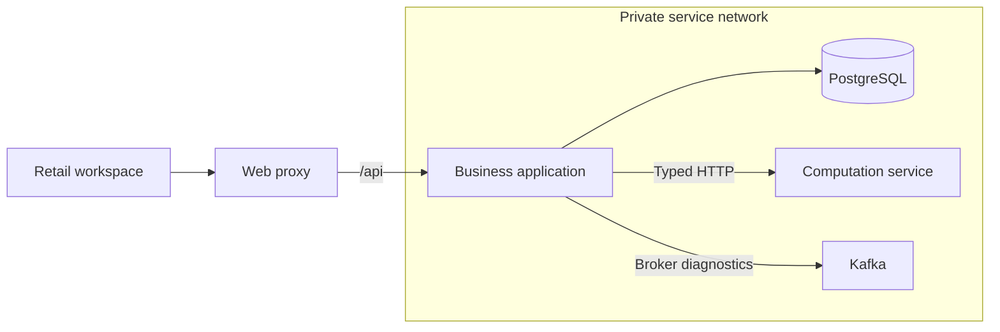

# Architecture

StockRescue organizes retail teams around organizations, stores, storage
compatibility and approved transport assumptions. PostgreSQL holds the operational
records; the Java backend authorizes commands and commits their audit evidence.

## Runtime responsibilities

| Component | Responsibility |
| --- | --- |
| Java / Spring Boot | Accounts, organizations, access decisions, store configuration and transport cost history in one modular application. |
| PostgreSQL | Business records, constraints, transaction ordering, audit history and persisted sessions. |
| React / TypeScript | Account and organization workspaces, forms, scoped navigation and service status. |
| Python / FastAPI | A private computation service with a versioned health contract. |
| Kafka | Broker connectivity and message transport checks. |
| Nginx / Docker Compose | Same-origin browser access and the local service topology. |

The web proxy publishes the local loopback port. Service addresses and database
credentials are supplied explicitly. The Java application uses the restricted
`stockrescue_app` database role; the computation service has its own configuration.

Liveness checks the Java process, readiness checks its database connection, and
integration health checks Kafka and Python separately. The workspace displays the
backend's readiness result. Broker message checks use isolated temporary topics.

## Application boundaries

Feature packages keep HTTP controllers, application use cases, domain rules and
JDBC repositories together:

| Package | Business responsibility |
| --- | --- |
| `identity` | Registration, credentials, authentication and active account status. |
| `organizations` | Organization creation and the creator's durable onboarding result. |
| `access` | Memberships, invitations, store assignments, revocation and authorization policy. |
| `stores` | Store metadata, storage zones, directed transport lanes and cost revisions. |
| `platform` | HTTP/security adapters, sessions, transactions, correlation and audit persistence. |

Controllers validate and translate requests. Application services own command
transactions and delegate SQL to repositories. Organization creation calls the
access use case to establish initial ownership in the same transaction. Store
commands obtain authorization through the shared access policy.

## Accounts and sessions

Account identity uses trimmed ASCII email addresses normalized to lowercase.
Passwords are hashed with BCrypt at cost 12. Passphrases contain at least 12
characters and at most 72 UTF-8 bytes. Registration returns the same acknowledgement
for a new or existing address. Five failed attempts within 15 minutes temporarily
lock further sign-in; hashing work has a bounded concurrency limit.

Server-side sessions persist in PostgreSQL. Authentication rotates the session
identifier. Sessions have a 30-minute idle timeout and a 12-hour maximum age;
protected requests recheck active account status. Cookies are host-scoped,
HttpOnly and SameSite=Lax. Secure cookies are the deployment default; the local
HTTP profile configures local development cookies explicitly.

Unsafe requests require a session-bound CSRF value. The frontend keeps it in
memory, refreshes it at authentication boundaries and discards rejected values.
Nginx limits authentication and CSRF bootstrap traffic to two requests per second
per peer, with a burst of six. Authentication payloads have a 4 KiB limit and the
proxy bounds request bodies to 16 KiB.

## Organizations and team access

Creating an organization atomically records the organization, its initial Org
Admin membership, the onboarding retry result and audit entries. A creator-row
lock serializes concurrent requests. Replaying an unchanged request returns the
recorded result after rechecking current access. Each account completes its own
organization onboarding once; invitations establish additional memberships.

Memberships and store assignments have independent scopes:

| Role | Authority |
| --- | --- |
| Org Admin | Manage the organization's members, invitations, stores, zones, lanes and costs; inspect archived store history. |
| Store Manager | Read assigned active stores and edit their metadata and storage zones. |
| Inventory Operator | Read assigned active stores and their configuration. |
| Read-only Analyst | Read assigned active stores and their configuration. |

Every protected operation resolves the current account, active organization
membership and relevant store assignment. Organization selection identifies the
workspace being viewed; authorization comes from persisted membership and grants.
Resource queries include organization scope, and composite foreign keys preserve
that relationship during writes.

An invitation contains the intended email address and administrator-selected
store assignments. Its 32-byte random secret is shared through a private link;
PostgreSQL stores the digest. Invitations expire after 24 hours and are consumed
once by a signed-in account matching the intended address. A pending invitation
also requires its issuer to remain an active Org Admin.

Claiming creates a pending membership. An administrator verifies the intended
person through a trusted channel and compares their signed-in account reference
before approval activates membership and planned store assignments. Invitations
are shared manually. Creation and redemption have durable per-account limits.

Role, membership and grant changes require current versions and business reasons.
Revoking membership also revokes its active store grants. Rejoining uses a new
invitation and identity review. Last-administrator checks preserve an active Org
Admin, and store grants are assigned to another active member.

## Stores and storage zones

A store has a stable UUID and an uppercase organization-scoped code. The code
remains reserved after deactivation. Store names, addresses, ISO country codes
and named IANA timezones are editable with the current version and a reason.
Named timezones retain daylight-saving rules. Store lists return the actor's
authorized records with literal name/code search and deterministic pagination.

Store deactivation retains identity and history while closing the store to new
commands. Administrators retain access to its archived configuration.

Storage zones declare AMBIENT, CHILLED or FROZEN compatibility. Their names are
unique within the store after normalization. Zone identity and temperature class
stay fixed; names are editable and deactivation is permanent. These attributes
describe declared compatibility.

## Transport lanes and approved costs

A transport lane describes one directed pair of distinct active stores in the
same organization. Its store endpoints stay fixed. Configuration selects active
zones with the same temperature class at both ends. Org Admins manage lanes and
approve cost revisions.

A cost revision records a decimal amount, supported ISO currency, positive whole
minutes per journey, effective time and approving membership. Amounts cross HTTP
as decimal strings and use BigDecimal / PostgreSQL NUMERIC. They support four
fractional digits and values below 10^15. The API publishes the country currencies
recognized by the running JDK; recorded historical currencies remain readable.

Approvals append immutable revisions and advance the lane version. Each revision
preserves the selected zone identifiers and temperature class. Changing the zone
pair requires a fresh cost approval for that compatibility evidence.

Effective times have microsecond precision and increase with every revision.
Immediate approval uses server time; a scheduled approval uses an explicit future
time. Validity is `[effectiveAt, nextEffectiveAt)`, so a future price becomes current
at its effective time while earlier values remain retrievable.

Configuration states distinguish CONFIGURED, UNCONFIGURED and INACTIVE. The API
returns the applicable current cost when configuration is complete and active;
other states carry a null current cost and explicit reasons. An approved zero
amount represents an explicitly entered assumption.

## Transactions, history and persistence

Application records belong to the `stockrescue` schema. Flyway history stays in
`public.flyway_schema_history`, preserving the original baseline and its checksum.
Append-only migrations evolve the schema and are validated at application startup.
Pooled JDBC connections select the application schema explicitly.

UUIDs identify business records. PostgreSQL checks, unique constraints and
organization-aware foreign keys enforce relationship and value invariants.
Version checks detect concurrent edits. Audit entries, revocation records,
onboarding results and cost revisions preserve committed historical evidence.

Security changes acquire the organization lock exclusively. Protected store
commands share that lock, then lock the current account/membership, store and
relevant grant. Multi-store operations use stable identifier order. Membership is
rechecked after waiting for authority locks. A committed revocation therefore
blocks later authorization, while an already authorized command completes before
a waiting revocation. Last-admin checks run inside that serialized transaction.

Successful commands and their audit entries commit together. Audit records contain
the actor, organization, resource, action, relevant before/after values, reason
and correlation identifier. Transaction rollback restores data, versions and audit
state together. Account and invitation secrets are handled separately from these
business records.

## Workspace and HTTP contracts

The shared workspace connects account details, organization selection, stores,
storage zones, member access, lanes, cost history and settings. Store and member
responses provide allowed operations for the interface; commands validate current
authority when submitted.

Private query keys include actor, organization and applicable store or lane IDs.
Switching organizations closes the previous feature boundary, cancels requests
and clears its private cache. Role changes replace that boundary. Session expiry
closes private views, and cross-tab login/logout signals trigger session
revalidation. Focus and periodic reads refresh current authority.

Business HTTP routes use `/api/v1`; service health uses `/api/health`. Backend
models generate `contracts/http/openapi.yaml`, which generates the frontend's
typed client. CI checks both artifacts for drift. Error responses use stable
problem codes and correlation identifiers: authentication, permission, validation
and version conflicts have distinct HTTP statuses.

Dependency versions, locks and container digests define reproducible builds.
Frontend installation checks package integrity, release age and approved build
scripts. PostgreSQL constraint/concurrency tests and browser journeys exercise
the operational workflows against actual services.
